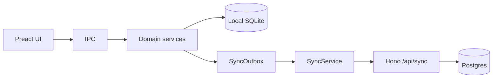
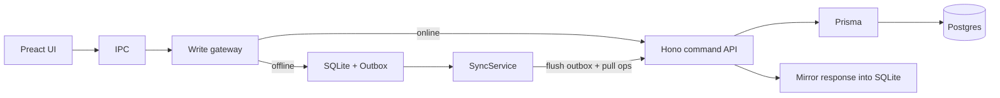

# Online-first backend with offline fallback

## Current state (reuse)



Today writes always hit SQLite first; sync only **pushes** ops and **pulls** masters. Two terminals at the same sales point cannot share live stock, invoice/DO numbers, or DO remaining balances. DeliveryOrder integer PKs collide across devices.

## Target architecture



- **Online:** main-process gateway calls command APIs; on success, apply the server response into local SQLite (cache for UI/offline).
- **Offline / API failure:** existing path — write SQLite, enqueue outbox; reconnect flushes via existing push, then pulls **operational deltas** scoped by `salesPointId`.
- **Prisma** lands on existing [`server/`](server/); keep `/api/sync/*` working during migration (hybrid: Prisma for new routes, raw `postgres` for sync until ported).

## Phase 1 — Prisma on existing server

- Add `prisma`, `@prisma/client` to [`server/package.json`](server/package.json); create `server/prisma/schema.prisma` mapped from [`server/schema/postgres_schema.sql`](server/schema/postgres_schema.sql) (same tables/columns; use `@@map` / `@map` for snake_case).
- Keep applying schema via current SQL migrate **or** switch new changes to Prisma migrate — pick **introspect existing DB + Prisma client only first** so you do not dual-migrate. Continue using `postgres_schema.sql` + `db:migrate` as source of truth initially; regenerate Prisma client after schema edits.
- Add `server/src/db/prisma.ts` singleton; wire health check to `prisma.$queryRaw`.
- Do **not** rewrite all of [`sync.ts`](server/src/routes/sync.ts) in phase 1.

## Phase 2 — Server command APIs (multi-user coordination)

Add Hono routes under `/api/v1/` with existing device Bearer auth ([`server/src/middleware/auth.ts`](server/src/middleware/auth.ts)), scoped by device `sales_point_id`.

**Must be server-authoritative (shared at a collection point):**

| Concern                          | Why                                          | Approach                                                                                                                       |
| -------------------------------- | -------------------------------------------- | ------------------------------------------------------------------------------------------------------------------------------ |
| Invoice / DO / stock doc numbers | Local `MAX+1` collides                       | `POST /api/v1/sequences/allocate` (or allocate inside create sale/DO) with row lock / Postgres sequence per sales point + kind |
| Booklet serials                  | Validation-only locally                      | Check uniqueness + optional consume/mark used in same TX as create                                                             |
| Stock                            | Local balances diverge                       | Create/validate sale and stock docs adjust `stock_movements` / balances on server in one TX                                    |
| DeliveryOrder IDs                | Integer `lastInsertRowid` overwrites on push | New DOs use text/UUID PKs like Sale (`createTextPrimaryKey` style); migrate path for existing rows                             |
| Cross-terminal reads             | Ops never pulled today                       | `GET` list/detail by sales point + incremental `GET /api/v1/ops/pull?since=` for sales, DOs, stock docs, movements             |

Implement first command handlers with Prisma (start with the highest traffic path):

1. `POST /api/v1/sales` — create/validate sale (allocate number, stock check/deduct, return full aggregate)
2. `POST /api/v1/delivery-orders` — create/update DO
3. Stock receipt/transfer/adjustment create endpoints
4. `GET /api/v1/ops/pull` — operational delta for the device’s sales point

Keep [`POST /api/sync/push`](server/src/routes/sync.ts) for offline outbox flush (same upsert semantics). Extend pull (sync or v1) so **operational** rows for that sales point flow back to other terminals.

## Phase 3 — Electron write gateway (online-first + fallback)

Insert a thin gateway used by domain services ([`sales/service.ts`](src/electron/sales/service.ts), [`deliveryOrders/service.ts`](src/electron/deliveryOrders/service.ts), [`stock/service.ts`](src/electron/stock/service.ts)) — UI/IPC unchanged.

```ts
// Pseudocode pattern
async function createSale(input) {
  if (networkMonitor.getOnlineStatus()) {
    try {
      const remote = await apiClient.createSale(input);
      await applySaleAggregateLocally(remote); // mirror cache
      return remote;
    } catch (e) {
      if (!isConnectivityOr5xx(e)) throw e; // validation errors surface
    }
  }
  // offline / unreachable: existing local write + enqueueOutboxItem
  return createSaleLocally(input);
}
```

- Add `src/electron/api/client.ts` (fetch to sync server base URL + device token from `SyncState`).
- Reuse [`NetworkMonitor`](src/electron/sync/networkMonitor.ts) for the online check.
- On reconnect: existing `SyncService.syncNow` push, then **new** ops pull applied into SQLite (same upsert helpers as master pull).
- Fix local DO create to use text/UUID IDs so offline creates remain merge-safe.

## Phase 4 — Multi-user UX at one sales point

- After ops pull (and periodically while online), refresh lists so Terminal B sees Terminal A’s sales/DOs/stock.
- Prefer short online poll or pull-on-focus for shared screens (DO remaining, stock balances, booklet used pages) rather than rewriting the UI to call HTTP directly.
- Auth stays local session for now; users continue to sync via master pull. Device API key remains the server principal.

## Explicit non-goals (keep scope sane)

- No second Hono app; no Prisma on the Electron/SQLite side.
- Renderer still never talks HTTP — only main process.
- No full rewrite of sync to CRDTs; last-write-wins + server allocation for contested resources.
- Admin/master CRUD can stay local+bootstrap/pull until a later pass.

## Risk order (fix first)

1. DeliveryOrder PK strategy (UUID/text) before multi-device DO create
2. Server number allocation + unique constraints
3. Server stock TX on sale validate
4. Gateway + offline fallback
5. Operational pull between terminals

## Success criteria

- Two devices, same `salesPointId`, both online: create sales without duplicate invoice numbers; stock cannot oversell; each sees the other’s recent ops after pull.
- Either device offline: can still sell into local SQLite; on reconnect, outbox pushes and peers receive ops via pull.
- Existing single-device offline-first behavior remains the fallback path.
