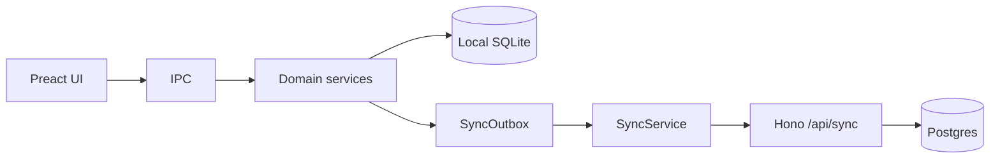
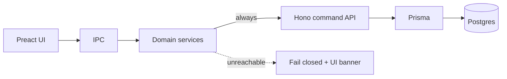

# Online-only server-authoritative backend

## Decision

The product is **online-only**: no local SQLite write path, no SyncOutbox offline queue, and no “sell while offline then sync later” fallback. If the API is unreachable, mutations fail and the UI shows that clearly.

Local SQLite may remain temporarily as a **legacy bootstrap/dev artifact** during migration, but it is not a runtime fallback for business writes.

## Current state (today)



Writes hit SQLite first; sync pushes ops and pulls masters. Two terminals at the same sales point cannot share live stock, invoice/DO numbers, or DO remaining balances.

## Target architecture



- **All business writes and authoritative reads** go to Postgres via Hono + Prisma.
- **Renderer never talks HTTP** — only the Electron main process (same as today).
- **No offline outbox.** Reconnect simply restores API access; there is nothing to flush from a local queue.
- Optional later: browser UI can call the same API (aligned with [hono_backend_split](hono_backend_split_7bee0f84.plan.md)); this plan focuses on Electron → command API first.

## Phase 1 — Prisma on existing server

- Add `prisma`, `@prisma/client` to [`server/package.json`](server/package.json); create `server/prisma/schema.prisma` from [`server/schema/postgres_schema.sql`](server/schema/postgres_schema.sql) (`@@map` / `@map` for snake_case).
- **Introspect existing DB + Prisma client first**; keep `postgres_schema.sql` + `db:migrate` as schema source of truth initially; regenerate client after schema edits.
- Add `server/src/db/prisma.ts` singleton; wire health check to `prisma.$queryRaw`.
- Do **not** rewrite all of [`sync.ts`](server/src/routes/sync.ts) in phase 1 (sync may remain for master data / cutover only).

## Phase 2 — Server command APIs (multi-user coordination)

Add Hono routes under `/api/v1/` with device/session Bearer auth ([`server/src/middleware/auth.ts`](server/src/middleware/auth.ts)), scoped by `sales_point_id` where applicable.

**Must be server-authoritative (shared at a collection point):**

| Concern | Why | Approach |
| --- | --- | --- |
| Invoice / DO / stock doc numbers | Local `MAX+1` collides | Allocate inside create (or `POST /api/v1/sequences/allocate`) with row lock / Postgres sequence per sales point + kind |
| Booklet serials | Validation-only locally | Uniqueness + consume/mark used in same TX as create |
| Stock | Local balances diverge | Create/validate sale and stock docs adjust movements/balances on server in one TX |
| DeliveryOrder IDs | Integer PK collisions | Text/UUID PKs like Sale; migrate existing rows |
| Cross-terminal reads | Ops never shared | List/detail (+ optional `since` pull) for sales, DOs, stock docs, movements by sales point |

Implement first with Prisma (highest traffic first):

1. `POST /api/v1/sales` — create/validate sale
2. `POST /api/v1/delivery-orders` — create/update DO
3. Stock receipt/transfer/adjustment endpoints
4. `GET` list/detail (and optional incremental ops) for the device’s sales point

## Phase 3 — Electron online-only gateway

Domain services ([`sales/service.ts`](src/electron/sales/service.ts), [`deliveryOrders/service.ts`](src/electron/deliveryOrders/service.ts), [`stock/service.ts`](src/electron/stock/service.ts)) call the API only. UI/IPC shape stays the same.

```ts
// Pseudocode — no SQLite fallback
async function createSale(input) {
  if (!networkMonitor.getOnlineStatus()) {
    throw new Error("Server unreachable. Check the network and try again.");
  }
  return apiClient.createSale(input);
}
```

- Add `src/electron/api/client.ts` (fetch to server base URL + auth token).
- Reuse [`NetworkMonitor`](src/electron/sync/networkMonitor.ts) to fail fast when offline.
- On API validation errors (4xx): surface to UI as today.
- On connectivity / 5xx: fail closed; do **not** write local SQLite or enqueue outbox.
- Retire write-side SyncOutbox usage for sales/DO/stock as those paths move online-only.
- Fix DO create to use text/UUID IDs on the server (and stop allocating local integer IDs).

## Phase 4 — Multi-user UX at one sales point

- While online, refresh lists so Terminal B sees Terminal A’s sales/DOs/stock (pull-on-focus / short poll).
- Show a clear banner when the server is unreachable; disable Save / Validate / Post actions.
- Auth: keep local login UX for now if needed, but **authorize mutations with server session/device token**; do not trust client-supplied `userId` for permission.

## Explicit non-goals

- No offline SQLite + outbox fallback for business ops.
- No Prisma on the Electron/SQLite side.
- Renderer still never talks HTTP directly.
- No CRDT sync model; server allocation + transactions for contested resources.
- Admin/master CRUD can move to API in a later pass if still local during cutover.

## Risk order (fix first)

1. DeliveryOrder PK strategy (UUID/text)
2. Server number allocation + unique constraints
3. Server stock TX on sale validate
4. Electron API client + remove local write fallback
5. Connectivity UX (fail closed, no silent local save)

## Success criteria

- Two devices, same `salesPointId`, both online: create sales without duplicate invoice numbers; stock cannot oversell; each sees the other’s ops via API reads.
- If the server is unreachable: user cannot complete a sale/DO/stock post; UI explains why; no divergent local ledger is created.
- No dependency on SyncOutbox flush to reconcile contested resources after reconnect.
